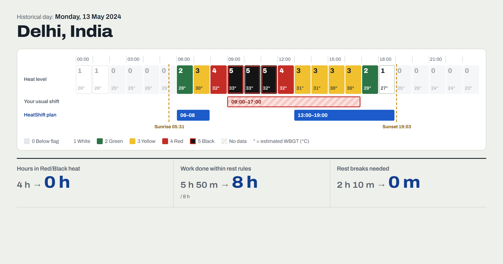
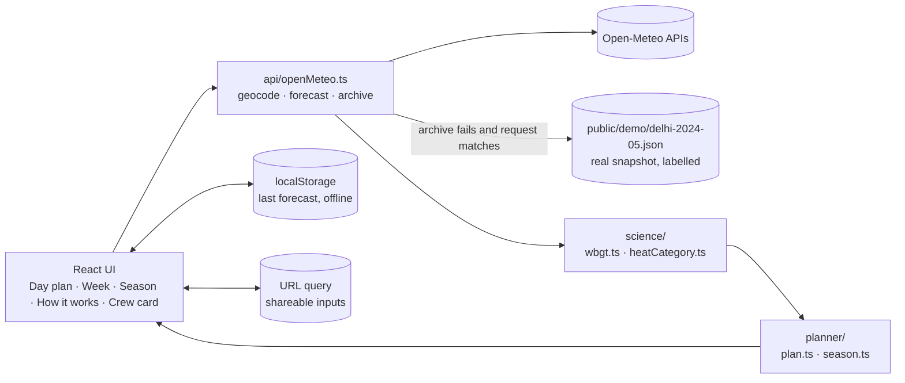

# HeatShift: same work, cooler hours

HeatShift turns a real heat forecast into a safer shift for outdoor workers. It estimates heat stress for every hour, applies published work/rest limits and moves the work into the coolest hours that still get the job done. It then shows exactly how much dangerous heat the plan removed.



> **Delhi, 13 May 2024 (real Open-Meteo data), moderate work, 8 hours needed.** The usual 09:00–17:00 shift spends **4 hours in Red/Black heat** and delivers only **5 h 50 m** of work once the mandatory rest breaks are taken. HeatShift's plan (06:00–08:00 + 13:00–19:00) spends **0 hours** in Red/Black heat and delivers the **full 8 hours**.
>
> **Season replay, Delhi, May 2024.** The usual shift spent **165 hours** in Red/Black heat over the month; HeatShift plans needed **127** and got **59 h 10 m more work** done within the rest rules. Every number is computed by the app from Open-Meteo data, not typed in.

**Live demo: https://heatshift-three.vercel.app** · Source: https://github.com/ayushgade06/heatshift · Built for [Code for Change](https://code-for-change-global.devpost.com/) (November 2026).

## The problem

The ILO estimates that more than 2.4 billion workers are exposed to excessive heat, causing 22.87 million occupational injuries and 18,970 deaths a year ([ILO, April 2024](https://www.ilo.org/resource/news/climate-change-creates-cocktail-serious-health-hazards-70-cent-worlds)). Most of that exposure happens on ordinary hot days, not declared heatwaves. Supervisors check the temperature, then keep the same 9-to-5 anyway, because nothing turns a forecast into a schedule. Weather apps show temperature; the OSHA-NIOSH Heat Safety Tool shows hourly heat-index risk but leaves the planning to you.

## What it does

1. **Day plan.** Pick a place (search or GPS). HeatShift fetches the hourly forecast and draws a 24-hour heat ruler. Your usual shift sits on it as a hatched red bar. Press **Plan safer shift**: the plan slides in and the before/after counters show Red/Black hours, work actually delivered under the rest rules, and rest needed.
2. **Crew card.** The plan becomes a printable A4 card: work hours, work/rest pattern for hot hours, water per hour, heat-illness warning signs, first aid and acclimatisation advice. Share it to WhatsApp, copy it, or have it read aloud. Available in **English, Hindi, Marathi and Spanish**.
3. **Week.** Seven days at a glance, with the coolest day marked. Select a day to open its plan.
4. **Season replay.** Run the planner on up to 31 days of real historical weather and see the totals avoided. One click loads Delhi's May 2024 heatwave.
5. **How it works.** Every formula, the full work/rest table (rendered from the same constant the planner uses), the planner's objective, limitations and sources.

No account, no tracking, no cookies. Inputs live in the URL so a plan can be shared as a link.

## How it works

**Heat stress per hour.** Forecasts don't include WBGT (the occupational heat-stress index), so HeatShift estimates it with the Australian Bureau of Meteorology approximation from air temperature `T` (°C) and relative humidity `RH` (%):

```
e    = (RH / 100) × 6.105 × exp(17.27 T / (237.7 + T))      hPa
WBGT ≈ 0.567 T + 0.393 e + 3.94                               °C
```

**Heat level and limits.** WBGT maps to heat levels 0–5 (TB MED 507 flag thresholds 78 / 82 / 85 / 88 / 90 °F). Each level and workload has a work/rest cycle and water intake from **US Army TB MED 507 (2022), Table 3-2**. For example, level 4 (Red) at moderate work is 50 min work / 10 min rest and ¾ qt (0.7 L) of water per hour.

**Planner.** HeatShift enumerates every one- or two-block shift inside the allowed hours (blocks ≥ 2 h, ≥ 1 h apart, the last hour may be partial) and picks, in order: fewest Red/Black hours, then lowest heat dose (degree-hours above 25.6 °C WBGT), fewest clock hours, fewer blocks, earliest start. **Safety cap:** a plan never has more Red/Black hours than the usual shift. If the full job can't fit under that cap, HeatShift shows the most work that does fit and says so. Brute force over about a thousand candidates takes a few milliseconds.

## Architecture



A static single-page app: no backend, no database, no secrets. `science/` and `planner/` are pure TypeScript with no React imports.

| Layer | Choice |
|---|---|
| UI | Vite, React 19, TypeScript, hand-rolled CSS-grid/SVG visuals, Lucide icons, Archivo + Noto Sans Devanagari (self-hosted via Fontsource) |
| Data | Open-Meteo forecast, historical and geocoding APIs (keyless, CC BY 4.0) |
| Tests | Vitest + Testing Library (49 unit/component tests), Playwright (4 end-to-end tests) |
| Hosting | Vercel (static) |

**Resilience.** API errors surface Open-Meteo's own reason with a Retry button. If the historical API is down, a bundled snapshot of real Open-Meteo data for Delhi, May 2024 is used only when the request matches it (same place ±0.05°, dates inside the range) and is always labelled "Cached Open-Meteo data, fetched …". The last forecast is saved locally and shown with an "offline" banner if the network fails.

## Run it locally

```bash
npm install
npm run dev          # http://localhost:5173
```

```bash
npm test             # unit + component tests (no network)
npm run test:e2e     # Playwright smoke tests (uses your installed Chrome)
npm run typecheck
npm run build        # static output in dist/
npm run snapshot     # re-fetch the Delhi May 2024 demo snapshot from Open-Meteo
```

No environment variables are needed (see `.env.example`).

## Deploy

Any static host works. On Vercel: `npx vercel --prod` (framework preset: Vite, output: `dist`). Netlify or GitHub Pages work the same way with `npm run build`.

## Limitations

- **WBGT is an estimate.** The BoM formula assumes moderate sun and light wind and ignores measured radiation and wind; it can be wrong in cloud, wind or full midday sun. Independent studies find it less accurate than physical models. A site WBGT meter is better.
- **The table is for fit, acclimatised adults.** New or returning workers must build up gradually (NIOSH: at most 20% of usual heat exposure on day 1, adding at most 20% a day).
- Hourly resolution and forecast error. The plan is guidance for supervisors, **not medical advice**.
- Hindi, Marathi and Spanish strings are drafted translations; see `NOTES.md` for review status.

## Sources and licences

- US Army TB MED 507, *Heat Stress Control and Heat Casualty Management* (2022), public domain.
- Australian Bureau of Meteorology WBGT approximation.
- NIOSH acclimatisation guidance; OSHA heat-illness first aid.
- ILO (2024), *Ensuring safety and health at work in a changing climate*.
- Weather data by [Open-Meteo.com](https://open-meteo.com/) under [CC BY 4.0](https://creativecommons.org/licenses/by/4.0/).

Code: MIT licence. Built during Code for Change, November 2026, by Ayush Gade. **AI assistance disclosure:** this project was built with the help of an AI coding assistant (Claude); all science values were checked against the cited sources (see `NOTES.md`).
